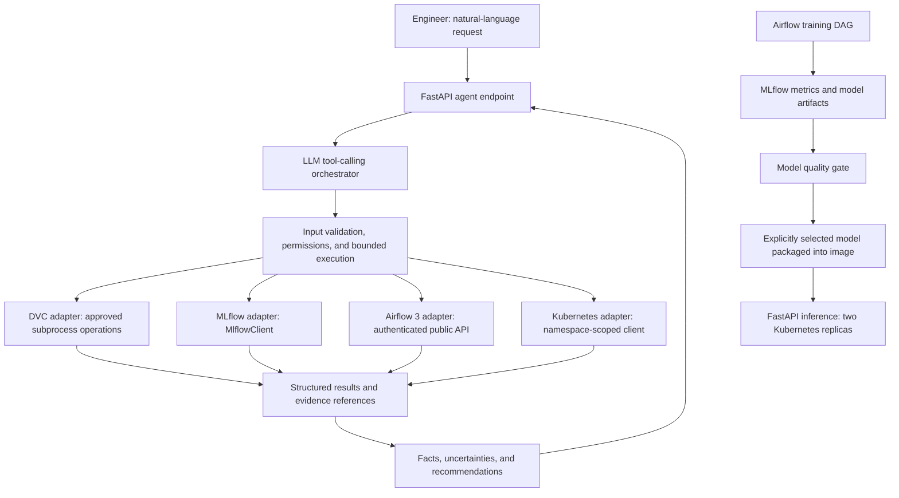

# Architecture

Status: DVC and MLflow tools, two dataset revisions, deterministic training and
model-artifact/lineage retrieval are implemented and live-verified. Versioned
inference and validated artifact packaging are implemented and live-verified in
a non-root Docker container against all 45 holdout predictions.
Kubernetes reads and two-replica cluster deployment are live-verified. Airflow 3
training, candidate gate and blocked-approval failures are live-verified. Airflow
agent tools and conversational orchestration remain planned.

## Application boundaries

The agent API provides conversational operations. The inference API loads a
specific trained model and predicts from validated feature inputs. These are
separate application responsibilities, even if they share a repository.

Training uses the bundled Iris dataset with a deterministic sensor-resolution
revision, stratified 70/30 splitting (seed 42), and macro F1 over labels 0/1/2.
Standardized logistic regression and random forests share one evaluation cohort.
Accuracy, F1 and log loss plus artifacts and exact provenance are recorded in
MLflow 3.6.0. The workflow candidate gate checks F1, accuracy, log loss and cohort size before
allowing a separate candidate approval task. It never deploys or promotes a registry
version; a high score alone does not establish production readiness. See [training policy](docs/mlflow.md).

## Provenance

Every training run must record the dataset path, DVC content hash, dataset Git
revision, code Git revision, split seed, and model configuration in MLflow. The
inference image must identify its application version, model run ID, and dataset
reference. Comparisons must identify the evaluation split and metric direction.

DVC implements the lineage keys `dataset_path`, `dataset_dvc_md5` and
`dataset_git_revision`. Its MLflow run resolver accepts a bounded run-lookup
callback, now connected to the MLflow adapter by the DVC CLI. The isolated client
worker bounds run lookup and artifact inspection; an absent callback still
produces an explicit unavailable response. Evaluation cohort IDs bind data bytes,
split indices and metric policy. Different cohorts cannot produce a global ranked
winner. Logged models use MLflow 3 model IDs and HTTP-proxied artifacts, rather
than host filesystem artifact paths.

A local DVC remote is sufficient for a local demonstration only if the repository
documents how a fresh checkout obtains the data. A remote stored outside Git is
not automatically available to a reviewer. A deterministic dataset preparation
command and remote bootstrap instructions must address this limitation.

## Tool contract and policy

Each tool accepts a validated input schema and returns a structured result with a
request ID, tool name, observation timestamp, status, evidence, and optional error.
Unavailable systems return explicit unknown or unavailable states. An LLM must not
fill missing observations with plausible operational claims.

DVC commands use fixed argument lists without a shell and validate repository
paths and revisions. MLflow uses supported client APIs. Airflow uses the versioned
public API and the configured authentication manager. Kubernetes reads are scoped
to the approved namespace with restricted credentials.

Cluster writes, if implemented, require explicit user confirmation bound to the
specific namespace, resource, and operation. The default agent has read-only
cluster access. Infrastructure installation by an engineer is separate from agent
permissions. Training is triggered only by a user request for the approved DAG;
the mandatory assessment request never triggers retraining automatically.

## Reliability and evidence

Tool execution has bounded timeouts, limited retries for safe transient failures,
and structured logs containing request ID, tool name, status, and duration. Secret
values and authentication headers are excluded. Tool output is untrusted data and
cannot expand permissions or add executable commands.

The mandatory multi-tool request correlates MLflow selection, the recorded DVC
reference, Kubernetes health/version, and recent Airflow workflow status. A
retraining recommendation must cite an explicit freshness policy, failed quality
gate, or supplied degradation measurement. Missing evidence yields uncertainty.

## Implementation references

- [Airflow 3 public API authentication](https://airflow.apache.org/docs/apache-airflow/stable/security/api.html)
- [MLflow client API](https://www.mlflow.org/docs/latest/api_reference/python_api/mlflow.client.html)
- [DVC checkout](https://dvc.org/doc/command-reference/checkout)
- [DVC diff](https://dvc.org/doc/command-reference/diff)
- [Kubernetes health probes](https://kubernetes.io/docs/tasks/configure-pod-container/configure-liveness-readiness-startup-probes/)
- [kind quick start](https://kind.sigs.k8s.io/docs/user/quick-start/)

## Airflow execution boundary

The `assignment_training` TaskFlow DAG uses five required stages followed by an
explicit candidate approval task, with all-success dependencies throughout.
Airflow 3.1.3 runs from a versioned image with a separate hash-locked scientific
Python environment. The read-only input snapshot records DVC/Git lineage and must
match the image's code SHA. Per-workflow dataset/split/model artifacts live in the
persistent Airflow volume; XCom carries small references. Evaluation uploads a
real MLflow model, metrics and lineage via the artifact proxy, and retries reuse
the workflow's recorded run ID. Gate rejection records failed evidence and prevents
approval; validation failure prevents all subsequent training/evaluation tasks.
See [workflow policy](docs/airflow.md) and [actual run evidence](docs/evidence/airflow-dag.md).
