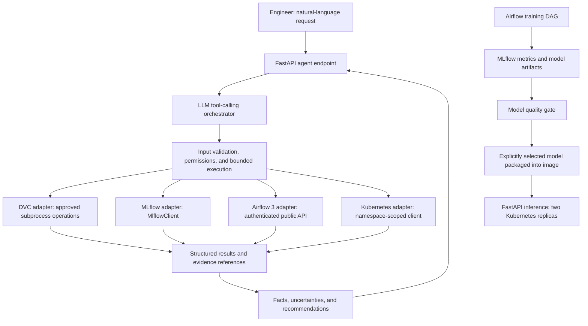

# Architecture

Status: DVC tools and deterministic data storage are implemented and live-verified.
The other operational adapters, training and agent orchestration remain planned.

## Application boundaries

The agent API provides conversational operations. The inference API loads a
specific trained model and predicts from validated feature inputs. These are
separate application responsibilities, even if they share a repository.

Training uses a small reproducible classification dataset, deterministic splitting,
and a documented F1 policy. The exact dataset, dependency versions, and acceptance
threshold will be recorded with the implementation. A high score alone does not
establish production readiness.

## Provenance

Every training run must record the dataset path, DVC content hash, dataset Git
revision, code Git revision, split seed, and model configuration in MLflow. The
inference image must identify its application version, model run ID, and dataset
reference. Comparisons must identify the evaluation split and metric direction.

DVC implements the lineage keys `dataset_path`, `dataset_dvc_md5` and
`dataset_git_revision`. Its MLflow run resolver accepts a bounded run-lookup
callback, which must be connected to the MLflow adapter during that milestone;
an absent callback produces an explicit unavailable response.

A local DVC remote is sufficient for a local demonstration only if the repository
documents how a fresh checkout obtains the data. A remote stored outside Git is
not automatically available to a reviewer. A deterministic dataset preparation
command and remote bootstrap instructions must address this limitation.

## Tool contract and policy

Each tool accepts a validated input schema and returns a structured result with a
request ID, tool name, observation timestamp, status, evidence, and optional error.
Unavailable systems return explicit unknown or unavailable states. An LLM must not
fill missing observations with plausible operational claims.

DVC commands use fixed argument lists without a shell and validate repository
paths and revisions. MLflow uses supported client APIs. Airflow uses the versioned
public API and the configured authentication manager. Kubernetes reads are scoped
to the approved namespace with restricted credentials.

Cluster writes, if implemented, require explicit user confirmation bound to the
specific namespace, resource, and operation. The default agent has read-only
cluster access. Infrastructure installation by an engineer is separate from agent
permissions. Training is triggered only by a user request for the approved DAG;
the mandatory assessment request never triggers retraining automatically.

## Reliability and evidence

Tool execution has bounded timeouts, limited retries for safe transient failures,
and structured logs containing request ID, tool name, status, and duration. Secret
values and authentication headers are excluded. Tool output is untrusted data and
cannot expand permissions or add executable commands.

The mandatory multi-tool request correlates MLflow selection, the recorded DVC
reference, Kubernetes health/version, and recent Airflow workflow status. A
retraining recommendation must cite an explicit freshness policy, failed quality
gate, or supplied degradation measurement. Missing evidence yields uncertainty.

## Implementation references

- [Airflow 3 public API authentication](https://airflow.apache.org/docs/apache-airflow/stable/security/api.html)
- [MLflow client API](https://www.mlflow.org/docs/latest/api_reference/python_api/mlflow.client.html)
- [DVC checkout](https://dvc.org/doc/command-reference/checkout)
- [DVC diff](https://dvc.org/doc/command-reference/diff)
- [Kubernetes health probes](https://kubernetes.io/docs/tasks/configure-pod-container/configure-liveness-readiness-startup-probes/)
- [kind quick start](https://kind.sigs.k8s.io/docs/user/quick-start/)
